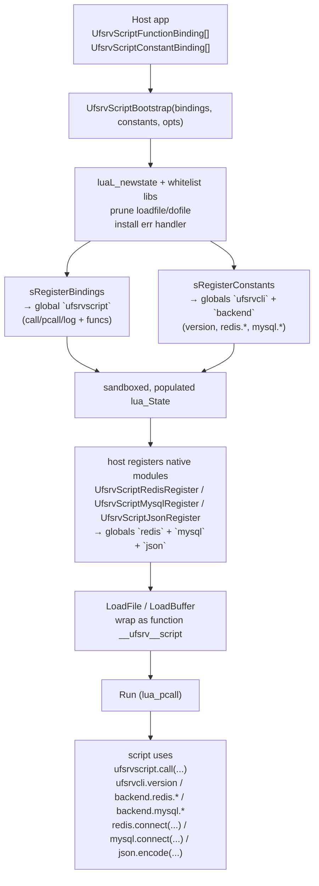

# ufsrvscriptlib — Technical Design

## Version Management

| Service Name | Date Created | Created By |
|---|---|---|
| ufsrvscriptlib | 2026-09-05 | devops |

| Version | Date Modified | Modified By | Description |
|---|---|---|---|
| 1.0.0 | 2026-09-05 | devops | Add Appendix A — original Redis Lua design review |
| 1.1.0 | 2026-09-05 | devops | Add Appendix B — how Redis exports symbols to Lua |
| 1.2.0 | 2026-09-05 | devops | Document the UfsrvScriptConstant[] globals array (dotted-path tables) |
| 1.3.0 | 2026-09-05 | devops | Defer: arrays (sequential tables) extension proposal |
| 1.4.0 | 2026-09-05 | devops | Add main body: constants vs. bindings (typed data, untyped code) |
| 1.5.0 | 2026-09-05 | devops | Rename types (*FunctionBinding/*ConstantBinding) and Lua global (ufsrvscript) |
| 1.6.0 | 2026-09-05 | devops | Document bindings-retained vs constants-consumed storage/lifetime |
| 1.7.0 | 2026-09-05 | devops | Add pipeline visual flow (bootstrap → exported symbols) |
| 1.8.0 | 2026-09-05 | devops | Future ext: replace linear command lookup with a hash/dict |
| 1.9.0 | 2026-09-05 | devops | Add quick guide with CLI usage samples |
| 1.10.0 | 2026-09-05 | devops | Add known issues (fragile stack indices in sRegisterConstant) |
| 1.11.0 | 2026-09-05 | devops | Expand known issues: full stack trace + remediation |
| 1.12.0 | 2026-09-05 | devops | Resolve known issue: sRegisterConstant uses absolute container index |
| 1.13.0 | 2026-09-05 | devops | Document sandbox library whitelist, `require` gating, and luasocket unavailability |
| 1.14.0 | 2026-09-05 | devops | Document the native Lua module (`lua_bindings`) interface contract |
| 1.15.0 | 2026-09-05 | devops | Sync quick guide / pipeline / sandbox section with the redis module + `backend.redis.*` constants |
| 1.16.0 | 2026-09-05 | devops | Add the mysql module + `backend.mysql.*` constants to the quick guide / sandbox / native-module docs |
| 1.17.0 | 2026-09-06 | devops | Add the json codec module (lua-cjson) to the quick guide / pipeline / sandbox / native-module docs |
| 1.18.0 | 2026-09-09 | devops | Document the evaluator convenience API (one-shot + persistent, BufferDescriptor marshalling) |
| 1.19.0 | 2026-09-09 | devops | Add the programmer's guide — integration sequence + state model (one-shot / persistent, one state per thread) |
| 1.20.0 | 2026-09-09 | devops | Add Table of Contents; add the pb (protobuf) module to the module lists |

## Contents

- [Quick guide](#quick-guide)
- [Constants vs. bindings](#constants-vs-bindings)
  - [Constants are typed](#constants-are-typed)
  - [Bindings are untyped](#bindings-are-untyped)
  - [How a binding's return type is distinguished](#how-a-bindings-return-type-is-distinguished)
  - [Storage and lifetime](#storage-and-lifetime)
- [The Lua pipeline](#the-lua-pipeline)
- [Sandbox libraries and `require`](#sandbox-libraries-and-require)
  - [`require` is gated by `is_package_allowed`](#require-is-gated-by-is_package_allowed)
  - [luasocket is not available](#luasocket-is-not-available)
- [Native Lua modules (`lua_bindings`)](#native-lua-modules-lua_bindings)
  - [The interface contract](#the-interface-contract)
  - [The object-model idiom](#the-object-model-idiom)
  - [Registration seam](#registration-seam)
  - [Layout](#layout)
- [Evaluator convenience API](#evaluator-convenience-api)
- [Programmer's guide — integration & state model](#programmers-guide--integration--state-model)
  - [Initialisation sequence](#initialisation-sequence)
  - [State model — one `lua_State` is the unit of isolation](#state-model--one-lua_state-is-the-unit-of-isolation)
- [Future extensions](#future-extensions)
- [Known issues](#known-issues)
- [Appendix A — Original Redis Lua design review](#appendix-a--original-redis-lua-design-review)
- [Appendix B — How Redis exports symbols to Lua](#appendix-b--how-redis-exports-symbols-to-lua)

## Quick guide

`ufsrvcli -s` (`--eval-script`) loads and runs a Lua script in the sandboxed
engine, then prints its result. Symbols reach the script three ways: read-only
globals (**constants**) are referenced directly; callable operations (**function
bindings**) go through the `ufsrvscript` table; and **native modules** (the
`redis`, `mysql`, `json`, and `pb` tables) expose richer objects — stateful for
`redis`/`mysql`, stateless codecs for `json` and `pb` (see "Native Lua modules").

```bash
# run a script file
ufsrvcli -s script.lua

# piped from stdin ("-" = stdin)
printf 'print(ufsrvcli.version)\n' | ufsrvcli -s -

# return a value — it is echoed as the script's result
printf 'return ufsrvcli.version\n' | ufsrvcli -s -

# reach a Redis backend via the constants + the native module
printf 'print(redis.connect(backend.redis.session.address, backend.redis.session.port):command("PING"))\n' | ufsrvcli -s -

# reach the MariaDB backend via the constants + the native module
printf 'print(mysql.connect(backend.mysql.host, backend.mysql.port, backend.mysql.user, backend.mysql.password, backend.mysql.database):ping())\n' | ufsrvcli -s -

# JSON encode/decode (stateless — no config or backend constants needed)
printf 'print(json.encode({ x = 1, y = { true, json.null } }))\n' | ufsrvcli -s -
```

```lua
-- script.lua
print("running ufsrvcli v" .. ufsrvcli.version)   -- a constant
local c = redis.connect(backend.redis.session.address, backend.redis.session.port)
print(c:command("PING"))                          -- the native redis module
local m = mysql.connect(backend.mysql.host, backend.mysql.port, backend.mysql.user, backend.mysql.password, backend.mysql.database)
print(m:query("SELECT 1"):fetch())                -- the native mysql module
print(json.encode({ n = 1, ok = true }))          -- the native json codec
-- ufsrvscript.call("register", { ... })          -- a function binding (when registered)
```

Today the CLI exports the `ufsrvcli.version` constant, the `backend.redis.*`
constants (`session`/`fence`/`usrmsg` address + port) and `backend.mysql.*`
(`host`/`port`/`user`/`password`/`database`) — both from the config — and the
`redis`, `mysql`, `json`, and `pb` native modules (`json` and `pb` need no
constants or config: they are stateless codecs). No function bindings are registered yet, so
`ufsrvscript.call("register", …)` returns an "unknown command" error until the
register/nonce/websock bindings land.

## Constants vs. bindings

The engine exposes two kinds of host-supplied values, and their shapes differ
for a reason: constants are **data**, bindings are **code**.

### Constants are typed

A `UfsrvScriptConstantBinding` is inert data. The engine must translate a C value (a
string, integer, or boolean) into a Lua value, and there is no code to ask
"what kind are you?", so the struct carries an explicit `type` discriminator
(`UFSRV_SCRIPT_CONSTANT_TYPE_STRING/INTEGER/BOOLEAN`) that tells the registrar
which `lua_push*` to call.

### Bindings are untyped

A `UfsrvScriptFunctionBinding` is a C function pointer (`UfsrvScriptFunctionBindingCallback` =
`int (*)(lua_State *)`). The function performs its own conversion — it pushes
its result onto the Lua stack and returns the count — so a static return-type
tag would be both redundant (the function already knows what it pushes) and
wrong (a binding's result can vary per call).

### How a binding's return type is distinguished

It is not, statically. The result is resolved dynamically by `sDispatch`:

1. the `int` return value is the *number* of results pushed (0 or 1);
2. the value(s) left on the Lua stack are the result, inspected at runtime
   (`lua_istable`, `lua_type`, `lua_isstring`) — never via a tag;
3. the only structural convention is the error contract: a table whose `err`
   field is a string signals failure (`ufsrvscript.call` raises it,
   `ufsrvscript.pcall` returns it); anything else is a success value passed
   through unchanged.

This mirrors Redis's `redis.call`/`redis.pcall` and `luaPushError`/`luaRaiseError`.

### Storage and lifetime

The two arrays are handled differently at bootstrap, for the same reason they
are typed differently: a function binding is *referenced* by the engine, a
constant is *copied*.

- **Function bindings are retained.** The handle stores the array
  (`struct UfsrvScriptLua.bindings`, "borrowed, static lifetime") because
  `sDispatch` looks bindings up by name at call time — every
  `ufsrvscript.call("name", …)` walks the array and invokes the matching C
  function pointer. The host must therefore keep the array alive for the
  handle's lifetime.

- **Constants are consumed once.** `sRegisterConstants` walks the array during
  bootstrap and pushes each value straight into the Lua globals; after that the
  value lives inside the `lua_State` (e.g. `ufsrvcli.version`) and the C-side
  array is never needed again. There is no runtime lookup by name, so the
  handle does not store the pointer.

The concrete consequence: the host may build its constants array on the stack
(consumed before bootstrap returns), but its function-bindings array must be
`static` (retained for dispatch lookup).

## The Lua pipeline

End-to-end: how the host's declared symbols become usable inside a script.

```text
     HOST (main.c → UfsrvScriptCliBootstrap)
     │
     │  exports two NULL-sentinel arrays:
     │   • UfsrvScriptFunctionBinding[]  { name, arity, func }    ── "register", "nonce", …
     │   • UfsrvScriptConstantBinding[]  { name, type, value }    ── "ufsrvcli.version", "backend.redis.*", "backend.mysql.*", …
     │
     ▼
 UfsrvScriptBootstrap(bindings, constants, opts)
     │
     ├── luaL_newstate()                    create the VM
     ├── sLoadWhitelistedLibs()             base/table/string/math/debug (+ os/package?)
     ├── sRemoveUnsupported()               prune loadfile / dofile
     ├── sInstallErrHandler()               errors as "source:line: msg"
     ├── sRegisterBindings()    ──────────► global `ufsrvscript` table
     │                                       { call, pcall, error_reply,
     │                                         status_reply, log, <funcs> }
     ├── sRegisterConstants()   ──────────► globals `ufsrvcli` + `backend` (dotted → nested)
     │                                       { version = "0.1.0" } and
     │                                       { redis = { session, fence, usrmsg },
     │                                         mysql = { host, port, user, password, database } }
     └── sInstallStrictGlobals() (opt)      strict.lua global guard
     │
     ▼
 sandboxed, populated lua_State
     │
     │  host registers native modules (post-bootstrap, before load):
     │   • UfsrvScriptRedisRegister(UfsrvScriptLuaState(lua)) ──► global `redis`
     │   • UfsrvScriptMysqlRegister(UfsrvScriptLuaState(lua)) ──► global `mysql`
     │   • UfsrvScriptJsonRegister(UfsrvScriptLuaState(lua))  ──► global `json`
     ▼
 UfsrvScriptLuaLoadFile / LoadBuffer       wrap body as `function __ufsrv__script() … end`
     │
     ▼
 UfsrvScriptLuaRun()                        lua_pcall under the err handler
     │
     ▼
 user script uses the exported symbols:
      ufsrvscript.call("register", {…})     ← function binding (dispatched by name)
      ufsrvcli.version                      ← constant (plain global value)
      backend.redis.session.address/.port   ← constants (redis backend endpoints)
      backend.mysql.host/.port/.user/…      ← constants (mysql backend endpoints)
      redis.connect(...):command(...)       ← native module (userdata object)
      mysql.connect(...):query(...)         ← native module (userdata object)
      json.encode(...) / json.decode(...)   ← native module (stateless codec)
```



## Sandbox libraries and `require`

The engine opens only a fixed set of standard libraries
(`sLoadWhitelistedLibs`, `../../src/ufsrvscriptlib_lua.c`):

- always: `base`, `table`, `string`, `math`, `debug`
- optional: `os` (`is_os_allowed`) and `package` (`is_package_allowed`)

`loadfile`/`dofile` are pruned regardless (`sRemoveUnsupported`).

### `require` is gated by `is_package_allowed`

`require` lives in the `package` library, so it exists in the sandbox only when
`is_package_allowed` is true (default **false**):

```c
UfsrvScriptLuaOptions opts = { true, false, true };  /* package on */
UfsrvScriptLua *lua = UfsrvScriptBootstrap(bindings, constants, &opts);
```

The CLI wires `UfsrvScriptBootstrap(..., NULL)` (`../../../../src/ufsrvscriptlib/ufsrvscriptlib_cli.c`),
so it inherits the defaults and `require` is disabled in the shipped `ufsrvcli`.

Enabling it is a **security decision**, not a neutral flag flip: `luaopen_package`
installs `require` *and* sets `package.path`/`package.cpath`, so a script could
then load arbitrary `.lua`/`.so` modules off the filesystem search path.
`loadfile`/`dofile` stay pruned, but `require` is a separate loading path those
pruning steps do not block.

### luasocket is not available

luasocket (`socket.core`, `mime`) is not a standard library, so it is not in the
whitelist and is not linked. (`ufsrvscriptlib` links `uflib`, `liblua`, and — via
the redis/mysql bindings — the vendored `hiredis` and the system MariaDB
Connector/C; the `json` module links nothing extra, its vendored lua-cjson core
being pure C over libc. None of those provides luasocket.)
Enabling `require` therefore does **not** unlock it —
`require("socket")` would still fail with `module 'socket' not found`, because no
socket C module is registered or present on `package.cpath`.

Making socket available to scripts is a distinct, deliberate change (and a
security-relevant one, since it lets scripts reach the network): link and
register `luaopen_socket_core`/`luaopen_mime` (or install a matching
`socket/core.so` on the cpath) in addition to enabling `require`.

## Native Lua modules (`lua_bindings`)

A third, richer way to export symbols to scripts, alongside function bindings
(flat `ufsrvscript.call()` commands) and constants (scalar dotted-path data).
A **native module** is a self-contained C module that builds a Lua **table** —
and, where needed, userdata/metatable **objects** with methods — and sets it as
a global. It is the mechanism for stateful, connection-like objects (the Redis
`connect()` → userdata connection model) that the flat binding/constant model
cannot express.

### The interface contract

A native module **MUST**:

1. Expose exactly one entry point:
   `PUBLIC_API void UfsrvScript<Module>Register(lua_State *L);` — it builds the
   module table (functions, enums, sub-tables) and sets it with
   `lua_setglobal(L, "<module>")`.
2. Be registered by the **host** after `UfsrvScriptBootstrap()` and before any
   script is loaded/run, via `UfsrvScriptLuaState()`:
   `UfsrvScriptRedisRegister(UfsrvScriptLuaState(lua));`
3. Name its metatables `ufsrvscript.<module>.<type>` (e.g.
   `ufsrvscript.redis.connection`) and free any owned resource in a `__gc`
   metamethod (idempotent — guard against a user `:close()` followed by GC).
4. Prefix public C symbols `UfsrvScript<Module>*`; use `s`-prefixed `static`s
   for helpers.

A native module **MUST NOT**:

- Rely on registration order, or share state with other modules (each owns its
  global and metatables exclusively).
- Raise errors without the engine's `{ err = "..." }` convention. Module
  functions are called directly by Lua (not via `sDispatch`), so they may use
  the multi-return `nil, errstr, errno` form — but must be consistent within
  the module.
- Claim a global name another module owns.

### The object-model idiom

For stateful handles (connections, contexts):

- `lua_newuserdata` for the handle, with a metatable whose `__index` points to a
  method table (`command`, `close`, …) and a `__gc` that frees the C handle.
- Typed reply values as **const objects** — a `{ name, type }` table with a
  metatable — so scripts can test reply kind; a companion `unwrap_reply` exposes
  the raw `(name, type)` pair.
- Reach the module table with `lua_getglobal("<module>")` rather than
  lua-hiredis's fragile caller-upvalue idiom (`lua_upvalueindex` in a helper).

### Registration seam

`UfsrvScriptLuaState()` (documented as "pre-load extra libraries") is the escape
hatch: the host obtains the raw state after bootstrap. C-level `lua_setglobal`
is exempt from the strict-globals guard, so modules do **not** need to run
before `sInstallStrictGlobals`.

Registration is currently **manual** — one line per module in the host's
bootstrap. If the module list grows, a `UfsrvScriptNativeModule { name,
register_func }[]` array + loop is the cheap formalization (a host-side
convenience, not an engine change).

### Layout

| Concern | Location |
|---|---|
| Module implementation | `packages/ufsrvscriptlib/src/lua_bindings/<name>/ufsrvscriptlib_<name>.c` |
| Public header | `packages/ufsrvscriptlib/include/ufsrvscriptlib/ufsrvscriptlib_<name>.h` |
| Build wiring | `../../CMakeLists.txt` (source + any deps, e.g. `hiredis`, `mariadb`; `json` adds none) |
| Host registration | `../../../../src/ufsrvscriptlib/ufsrvscriptlib_cli.c` (`UfsrvScriptCliBootstrap`) |

The reference implementation is the Redis module
(`../../src/lua_bindings/redis/ufsrvscriptlib_redis.c`) — model
future modules on it. The MySQL module
(`../../src/lua_bindings/mysql/ufsrvscriptlib_mysql.c`) is the
second instance; the JSON module
(`../../src/lua_bindings/json/ufsrvscriptlib_json.c`) is the third
— a stateless codec whose seam is a registration shim (no userdata object model,
no external C API to wrap). The protobuf module
(`../../src/lua_bindings/protobuf/ufsrvscriptlib_protobuf.c`) is
the fourth — a codec-plus-schema-registry whose seam loads two pure-Lua
companions (`protoc`, `serpent`) in a private `_ENV`.

## Evaluator convenience API

The lifecycle API (bootstrap → load → run → close) is the full surface. For the
common "evaluate a Lua string and give me the result" case — the shape the
server's console EVAL (`UfsrvConsoleScriptEvalLua`) already uses — a thin
one-shot/persistent wrapper is provided over it (`ufsrvscriptlib_eval.h` /
`ufsrvscriptlib_eval.c`):

```c
BufferDescriptor *UfsrvScriptEval(const char *script, BufferDescriptor *buffer);            /* one-shot */
UfsrvScriptLua   *UfsrvScriptEvalOpen(const UfsrvScriptLuaOptions *opts);                   /* persistent */
BufferDescriptor *UfsrvScriptEvalRun(UfsrvScriptLua *lua, const char *script, BufferDescriptor *buffer);
```

- **One-shot** — `UfsrvScriptEval` bootstraps a fresh sandboxed VM (default
  policy), loads and runs the script, marshals the single return value into the
  buffer, and closes the VM.
- **Persistent** — `UfsrvScriptEvalOpen` returns a caller-owned VM kept across
  calls; `UfsrvScriptEvalRun` loads and evals into it, so globals (and any
  registered bindings/constants/modules) persist; `UfsrvScriptLuaClose` tears it
  down.

Marshalling matches the server console EVAL: `nil` → `"null"`, boolean →
`"true"`/`"false"`, a number/string via `lua_tostring`, and any other value
(table/function/userdata) as an empty string. A load/runtime failure writes
`{"error":"…"}`. `buffer` may be NULL (a fresh descriptor is allocated; the
caller frees it with `BufferDescriptorRelease()` then `free()`), or a
`BufferDescriptorInit`'d buffer (truncated and reused).

This is the only public surface that depends on uflib's `BufferDescriptor`; the
core `ufsrvscriptlib_lua.h` stays buffer-free.

## Programmer's guide — integration & state model

The "how do I actually wire this in" section: the canonical initialisation order,
and the one decision every consumer makes up front — how to hold the Lua state.

### Initialisation sequence

For full control (bindings + constants + modules), use the lifecycle API in this
order:

```c
#include <ufsrvscriptlib/ufsrvscriptlib.h>

/* 1. Bindings — callable operations. Retained; the array must outlive the handle. */
static int sEcho(lua_State *L) { lua_pushvalue(L, 1); return 1; }  /* echo arg #1 */
static const UfsrvScriptFunctionBinding bindings[] = {
    { "echo", 1, sEcho },
    { NULL, 0, NULL }
};

/* 2. Constants — read-only globals. Consumed once; a stack array is fine. */
static const UfsrvScriptConstantBinding constants[] = {
    { "app.version", UFSRVSCRIPTLIB_CONSTANT_TYPE_STRING, "1.0.0", 0, 0 },
    { NULL, UFSRVSCRIPTLIB_CONSTANT_TYPE_NONE, NULL, 0, 0 }
};

/* 3. Bootstrap the sandboxed VM (NULL opts = strict globals on, os/package off). */
UfsrvScriptLua *lua = UfsrvScriptBootstrap(bindings, constants, NULL);

/* 4. (optional) native modules — after bootstrap, against the raw state. */
UfsrvScriptJsonRegister(UfsrvScriptLuaState(lua));
UfsrvScriptProtobufRegister(UfsrvScriptLuaState(lua));

/* 5. Load (compile) a script. */
if (UfsrvScriptLuaLoadFile(lua, "script.lua") != 0)
    fprintf(stderr, "%s\n", UfsrvScriptLuaErrorString(lua));

/* 6. Run — leaves the single return value on the stack. */
if (UfsrvScriptLuaRun(lua) != 0)
    fprintf(stderr, "%s\n", UfsrvScriptLuaErrorString(lua));

/* 7. Inspect the result at the top of UfsrvScriptLuaState(lua). */

/* 8. Close. */
UfsrvScriptLuaClose(lua);
```

Order is significant: bootstrap installs the sandbox and strict-globals guard,
so it must come first; modules register against the bootstrapped state; load and
run come last. (Registering a module before bootstrap is a use of an
uninitialised state.)

The one-shot evaluator collapses steps 3–8 into one call (see "Evaluator
convenience API"):

```c
BufferDescriptor *out = UfsrvScriptEval("return 1 + 1", NULL);
printf("%s\n", out->data ? out->data : "");
BufferDescriptorRelease(out);
free(out);
```

### State model — one `lua_State` is the unit of isolation

Globals, loaded native modules, and loaded protobuf schemas all live inside a
single `lua_State`. The library offers **two** ways to hold one:

| Pattern | API | Lifetime | When |
|---|---|---|---|
| **One-shot** | `UfsrvScriptEval` | a fresh VM is bootstrapped and closed per call; nothing persists | stateless single-shot eval |
| **Persistent** | `UfsrvScriptEvalOpen` + `UfsrvScriptEvalRun` (or `UfsrvScriptBootstrap` + `Load`/`Run`) | the caller owns one VM kept across calls; globals persist | long-lived processes, consoles, schema caching |

The "shared vs single" question reduces to a choice between those two: one-shot
creates and destroys a VM per script (simple, isolated, no cross-call state);
persistent reuses one VM (state survives, but you now own its lifetime).

**Thread rule — a `lua_State` is single-threaded.** Never hand the same
`UfsrvScriptLua*` to two threads. A multi-threaded host holds one persistent
handle *per thread* (e.g. a `_Thread_local` `UfsrvScriptLua*` created once and
never closed) — exactly the pattern the server console
(`UfsrvConsoleScriptEvalLua`) uses today, and the shape the drop-in
`ufsrvscriptlib` evaluator replaces it with.

## Future extensions

### Command lookup — linear scan → hash/dict

`sDispatch` resolves `ufsrvscript.call("name", …)` with a linear scan over
`UfsrvScriptFunctionBinding[]` — a `while` loop advancing until the name matches
or the NULL sentinel is reached. That is O(n); fine for a handful of static CLI
bindings, but it becomes the hot path as the set grows (register, nonce,
websock_handshake, config_get, …).

Redis does this with a dict keyed by command name (`lookupCommand`, O(1)). The
future step mirrors it: build a name → `UfsrvScriptFunctionBinding *` hash table
at bootstrap and have `sDispatch` resolve by name in O(1). The change is
localized to `sDispatch` plus a small table-build beside `sRegisterBindings`;
the binding array remains the source of truth, so the public API and the
NULL-sentinel contract are unchanged.

## Known issues

### Fragile negative stack indices in `sRegisterConstant`

**Status:** resolved (2026-09-05) — `sRegisterConstant` now captures an absolute container index; the fragile `-4`/`-2`/`-3` indices are gone.

`sRegisterConstant` builds dotted-path tables using top-relative (negative)
stack indices:

```c
lua_settable(lua_state_ptr, -4);   /* :353 — "4th from the top" */
lua_remove(lua_state_ptr, -2);     /* :355 — "2nd from the top" */
lua_settable(lua_state_ptr, -3);   /* :374 — "3rd from the top" */
```

#### Negative vs. positive indices

Lua stack indices come in two kinds: **positive = absolute from the bottom**
(`1` is the first thing pushed), **negative = relative to the top** (`-1` is the
top). The `-4` / `-2` / `-3` above are top-relative, so each only means the
right thing at the precise moment the stack has the right depth.

#### Full trace for `"ufsrvcli.version"` (one dotted segment)

| step | operation | stack (top →) |
|---|---|---|
| 0 | `lua_pushglobaltable` | `[G]` |
| 1 | `lua_pushlstring("ufsrvcli")` | `[G, key]` |
| 2 | `lua_gettable(-2)` | `[G, child]` |
| 3a | `lua_pop` | `[G]` |
| 3b | `lua_newtable` | `[G, T]` |
| 3c | `lua_pushlstring("ufsrvcli")` | `[G, T, key]` |
| 3d | `lua_pushvalue(-2)` | `[G, T, key, T']` |
| 3e | **`lua_settable(-4)`** | `[G, T]` — `-4` = `G` only because there are exactly 4 elements |
| 4 | **`lua_remove(-2)`** | `[T]` — `-2` = `G` only because there are exactly 2 elements |

The leaf then does `lua_settable(-3)` on `[T, key, value]` (three elements).

So `-4` = "the globals table, because it happens to be 4 slots down *right
now*". Nothing in the code asserts that — the trace comments
(`/* container, table, key, table */`) are the only guard.

#### Why it breaks silently

1. **The index is positional, not semantic.** If anyone inserts an extra
   `lua_push*` above, or the loop changes shape, `-4` stops pointing at the
   container and starts pointing at `T`, or `key`, or garbage.
2. **Lua's C API does not validate it.** A wrong negative index either hits a
   *valid-but-wrong* slot (silent corruption — you write into the wrong field of
   the wrong table) or an out-of-range slot (undefined behaviour / crash).
   No compile-time or runtime warning either way.

#### Resolution (applied) — use an absolute index

Capture the container's position once as a **positive** index, and refer to it
by that stable number forever:

```c
lua_pushglobaltable(L);
int container = lua_gettop(L);        /* absolute index (stable) */

while ((dot = strchr(p, '.')) != NULL) {
    lua_pushlstring(L, p, seg_len);
    lua_gettable(L, container);        /* child = container[key]  */
    if (!lua_istable(L, -1)) {
        lua_pop(L, 1);
        lua_newtable(L);
        lua_pushlstring(L, p, seg_len);
        lua_pushvalue(L, -2);
        lua_settable(L, container);    /* container[key] = table   */
    }
    lua_replace(L, container);         /* container = child        */
    p = dot + 1;
}
/* ... */
lua_settable(L, container);            /* container[key] = value   */
lua_pop(L, 1);
```

Here `container` is a fixed absolute slot (e.g. `1`) that never moves no matter
how much is pushed/popped above it; `lua_replace(L, container)` replaces the
container with the child *in place*, doing what `lua_remove(-2)` did but by
name, not "2 from the top". Applied; the 44-test suite stays green.

## Appendix A — Original Redis Lua design review

> Original design review of Redis 3.2.13's server-side Lua integration
> (`src/scripting.c`) and the proposed analogous architecture for ufsrv, written
> before the engine was implemented. Reproduced verbatim as a historical record;
> the implementation that followed (in `../..`) diverged in
> places — e.g. the global table is `ufsrvscript` (not `ufsrv`) and the binding
> descriptor is `UfsrvScriptFunctionBinding` (not `UfsrvCommand`). Redis line numbers
> refer to `redis-3.2.13/src/scripting.c`.

I've reviewed the Redis 3.2.13 Lua integration (`src/scripting.c`, 2389 lines) and the CLI's own module surface. Here's the proposed architecture.

### 1. What the Redis model actually is

Redis keeps **one long-lived `lua_State`** (`server.lua`), set up once at startup (`scriptingInit`, `scripting.c:896`), and reuses it for every script. Its design splits cleanly into six concerns, each in a distinct function:

| Concern | Redis | Location |
|---|---|---|
| Library whitelist | `luaLoadLibraries` (loads only base/table/string/math/debug/cjson/struct/cmsgpack/bit; `os`+`package` are compiled out) | `scripting.c:821` |
| Function pruning | `luaRemoveUnsupportedFunctions` (nils `loadfile`/`dofile`) | `scripting.c:840` |
| Globals protection | `scriptingEnableGlobalsProtection` (installs `strict.lua` metamethods on `_G`) | `scripting.c:852` |
| Binding registration | builds a `redis` table of C functions (`call`, `pcall`, `error_reply`, `status_reply`, `log`, `sha1hex`, …) via `lua_pushcfunction`/`lua_settable`, then `lua_setglobal` | `scripting.c:915` |
| Dispatch + marshalling | `redis.call`/`redis.pcall` → `luaRedisGenericCommand` (reentrancy guard, arg→argv, command lookup, execute, **reply→Lua conversion**) | `scripting.c:348` |
| Script wrapping + errors | `luaCreateFunction` wraps the body as `function f_<sha1>() … end`; the caller `lua_pcall`s it under a `__redis__err__handler` so errors come back as `source:line: msg` | `scripting.c:1145`, `1030` |

The elegance is that **everything a script can do goes through one table (`redis`) of clearly delineated C bindings**, and the error contract is uniform: `redis.call` raises on error (halts the script), `redis.pcall` returns a `{err="..."}` table instead.

### 2. Redis → ufsrvcli mapping

| Redis (server) | ufsrvcli (client) |
|---|---|
| `redis.call("SET", k, v)` → Redis command | `ufsrv.call("register", ...)` → ufsrvapi/ufsrvwebsock operation |
| `struct redisCommand` table (`lookupCommand`) | a small static `UfsrvCommand[]` table (register, nonce, websock_handshake, config_get, …) |
| RESP wire reply → Lua (`redisProtocolToLuaType`) | C result struct → Lua table (no wire format; we already have **mjson** for any JSON we need) |
| `server.lua_client` fake client | an operation context holding the resolved `UfsrvCliConfig` + a live `UfsrvApiRegistration`/`UfsrvWebsockClient` handle |
| EVAL/EVALSHA + SHA caching | `--eval file` (SHA caching is optional/nice-to-have) |
| `KEYS`/`ARGV` globals | `ARGV` only (we have no key-space) |
| server-only: replication, cluster, AOF, timeout hook, `SCRIPT KILL` | **dropped entirely** |

The one structural change I'd recommend beyond the port: **unify the VM.** Today `UfsrvCliConfigLoad` (`src/ufsrvcli_config.c:191`) creates a `lua_State`, runs the config, and *closes it*. The Redis model wants a single state created once, that (1) runs the config prelude, (2) registers the `ufsrv` bindings, then (3) runs the user script. That consolidation is the heart of the proposal — the config loader becomes a *prelude chunk in the same VM*, and the config table `ufsrv_cli` stays a plain global the script can also read.

### 3. Proposed layout

```
src/ufsrvcli_script/                # NEW — the Lua bindings module
├── ufsrvcli_script.h               # public: UfsrvCliScriptInit/Run/Close
├── ufsrvcli_script.c               # VM lifecycle + `ufsrv` table + sandbox
├── ufsrvcli_script_ops.c           # op-dispatch table + generic call/pcall + marshalling
├── ufsrvcli_script_marshal.c       # Lua↔C result conversion (uses mjson)
└── (reused snippets, inlined or copied under attribution)
```

The `ufsrv` table is deliberately distinct from `ufsrv_cli` (config) — that's your "clearly delineated" boundary:

```lua
-- user script (run via `ufsrvcli --eval reg.lua`)
local r = ufsrv.call("nonce")                       -- {ok=true, nonce="..."}
local a = ufsrv.call("register", {
    email       = ufsrv_cli.registration.email,
    e164number  = ufsrv_cli.registration.e164number,
    password    = ufsrv_cli.registration.password,
    nonce       = r.nonce,
    sms_retriever = ufsrv_cli.registration.android_sms_retriever,
})
if a.err then error("register failed: " .. a.err) end
print("cookie: " .. a.cookie)
```

### 4. Core pieces (and what's copyable verbatim)

**a) Sandbox + globals protection — copy near-verbatim.** `luaLoadLibraries` whitelist (`scripting.c:821`), `luaRemoveUnsupportedFunctions` (`:840`), and the `strict.lua` block (`:852–883`). These are pure Lua/API glue with zero Redis coupling — drop `cjson/struct/cmsgpack/bit` (we have mjson; keep `base/table/string/math/debug`).

**b) Error handler — copy near-verbatim** (`scripting.c:1030–1045`). Rename `__redis__err__handler` → `__ufsrv__err__handler`; identical otherwise. This gives `source:line: msg` errors for free.

**c) `error_reply`/`status_reply` — copy the pattern** (`luaRedisReturnSingleFieldTable`, `:670`). Trivial.

**d) The `ufsrv` table registration** — same `lua_pushcfunction`/`lua_settable`/`lua_setglobal` sequence as `scriptingInit` (`:915–999`), but the table is `ufsrv` and holds our bindings:

```c
lua_newtable(L);
lua_pushcfunction(L, ufsrv_call);      lua_setfield(L, -2, "call");
lua_pushcfunction(L, ufsrv_pcall);     lua_setfield(L, -2, "pcall");
lua_pushcfunction(L, ufsrv_error_reply); lua_setfield(L, -2, "error_reply");
lua_pushcfunction(L, ufsrv_status_reply); lua_setfield(L, -2, "status_reply");
lua_pushcfunction(L, ufsrv_log);       lua_setfield(L, -2, "log");
lua_setglobal(L, "ufsrv");
```

**e) Generic dispatch** — mirrors `luaRedisGenericCommand` but without the server baggage. The `inuse` reentrancy guard (`:365–373`) is worth keeping as-is (a binding that runs the persistent websock loop could otherwise re-enter via a debug hook). The dispatch table is the analogue of `lookupCommand`:

```c
typedef struct UfsrvCommand {
    const char *name;
    int         arity;      /* <0 = varargs, 0 = take table only, >0 = exact */
    int (*run)(lua_State *L, const UfsrvCommand *c, int argc); /* pushes result */
} UfsrvCommand;
static const UfsrvCommand ufsrv_commands[] = {
    { "nonce",            0, op_nonce },
    { "register",         0, op_register },
    { "websock_handshake",0, op_websock_handshake },
    { "config_get",       1, op_config_get },
    { NULL, 0, NULL },
};
```

`ufsrv_call`/`ufsrv_pcall` differ only in `raise_error`, exactly like `luaRedisCallCommand`/`luaRedisPCallCommand` (`:634–642`).

**f) Marshalling — simpler than Redis, don't copy.** Redis hand-parses RESP; we have no wire protocol, so each `op_*` fills a C struct (reusing the *existing* `UfsrvApiRegistration*`, `UfsrvWebsock*` modules unchanged) then pushes a Lua table. The one reusable idiom is the reply *convention*: success → `{ok="...", …fields}`, failure → `{err="..."}` (`redisProtocolToLuaType_Status`/`_Error`, `:163–181`), and nil bulk → `false` (`:154`). Keep that convention; skip the parser.

**g) Script wrapper + pcall** — reuse `luaCreateFunction` (`:1145`) to wrap the body as `function __ufsrv__script() … end`, then `lua_pcall(L, 0, 1, errhandler_idx)`. SHA caching (EVALSHA) is optional — I'd defer it.

### 5. CLI surface

- `-e`, `--eval <file>` — run the script through the bindings; `-` reads the script from stdin (consistent with `-c -`).
- `ARGV` global array (from positional args after the script) — we have no `KEYS` space.
- `--ldb`-style debugger is **out of scope** (Redis's LDB lives in `debug.c`, ~1k lines, tightly coupled to the server); flag it as a later layer.

### 6. Licensing note

Redis 3.2.13 is **BSD-3-Clause**. The two blocks I'd lift near-verbatim (`strict.lua` globals guard, `__err__handler`) are tiny and — for `strict.lua` — itself adapted from metalua (MIT). Copying them is fine *with a source attribution comment in the header*; I'd add a one-line `/* adapted from Redis src/scripting.c (BSD-3) */` to be safe. Nothing else needs verbatim copying.

### 7. Phasing (with authorization gates, per your constraints)

1. **VM unification** — refactor `ufsrvcli_config.c` to expose one shared `lua_State` instead of create/close-per-load. *Gate: no change to the `UfsrvCliConfig` struct or its consumers; main.c keeps working unchanged.*
2. **Bindings module skeleton** — `ufsrv` table + `call`/`pcall`/`error_reply`/`status_reply`/`log`, sandbox, strict globals, err handler, script wrapper. *Gate: builds clean under `asan-ubsan`, zero effect on existing `--register`/handshake paths.*
3. **Ops table + marshalling** — wire `nonce`/`register`/`websock_handshake`/`config_get` to the existing class modules (no logic change in those modules). *Gate: `ufsrvcli --eval` reproduces `--register` output byte-for-byte on the happy path.*
4. **CLI wiring + docs** — `--eval`, `ARGV`, `UFSRVCLI_HOWTO.md` + man page update.

Each gate is a stop-and-review point where the previous `--register`/handshake behavior must be unchanged before proceeding.

### Open questions before I write any code

1. **Binding table name** — I propose `ufsrv` (distinct from `ufsrv_cli` config). Agree, or do you prefer `ufsrv_cli.call(...)` / a single table?
2. **Dispatch shape** — faithful `ufsrv.call("register", {...})` (extensible, matches Redis), vs. thin first-class `ufsrv.register{...}` (simpler, diverges from the model). I recommend the `call`/`pcall` dispatcher since it's literally what you pointed at and scales to future ops.
3. **Structured args** — registration takes 5 named fields; a flat `call("register", email, e164, password, nonce, sms)` is order-fragile, so I propose a **single table arg** for structured ops. OK?
4. **Sandbox strictness** — do you want globals protection (strict.lua) on by default, or a `--lua-sandbox=off` escape hatch for dev? Redis 3.2 always enables it.

Want me to proceed to phase 1 (VM unification), or would you rather I write this proposal up as a design doc (`docs/UFSRVCLI_LUA_BINDINGS.md`) first for the record?

## Appendix B — How Redis exports symbols to Lua

> Supplementary note (added after implementation). Redis uses no bindings
> generator or FFI: everything a script can see is pushed onto the Lua stack by
> hand and registered as a table field or a global.

The mechanism is four Lua C API calls:

1. `lua_newtable(L)` — push an empty table (the container).
2. `lua_pushcfunction(L, fn)` — wrap a C function as a Lua-callable value
   (use `lua_pushcclosure(L, fn, n)` to close over `n` upvalues).
3. `lua_setfield(L, idx, "name")` — pop the value and store it as `table.name`.
4. `lua_setglobal(L, "name")` — pop the value and make it the global `name`.

In `scriptingInit` (`scripting.c:896`) Redis builds the `redis` table exactly
this way:

```c
lua_newtable(L);
lua_pushcfunction(L, redis_call);   lua_setfield(L, -2, "call");
lua_pushcfunction(L, redis_pcall);  lua_setfield(L, -2, "pcall");
/* ... error_reply, status_reply, log, sha1hex ... */
lua_setglobal(L, "redis");
```

Non-function values are pushed with `lua_pushstring` / `lua_pushinteger` /
`lua_pushnumber` before the `lua_setfield` / `lua_setglobal`. Redis's per-eval
`KEYS` / `ARGV` globals are tables built with `lua_newtable` + `lua_setglobal`
in `evalGenericCommand`.

### The engine's equivalent

`UfsrvScriptBootstrap` → `sRegisterBindings` (`ufsrvscriptlib_lua.c:300`) is a
direct port: `lua_newtable`, the helper functions via
`lua_pushcclosure` / `lua_pushcfunction` + `lua_setfield`, then the host's
`UfsrvScriptFunctionBinding[]` in a loop, then `lua_setglobal(L, UFSRV_SCRIPT_GLOBAL)`
(`"ufsrvscript"`).

### Global constants and tables

Read-only globals are registered through a separate `UfsrvScriptConstantBinding[]`
array (NULL-sentinel), passed to `UfsrvScriptBootstrap` alongside the bindings.
Each entry has a dotted `name` and a tagged scalar value (string / integer /
boolean). The engine builds any intermediate tables, so a name like
`"ufsrvcli.version"` becomes the global table `ufsrvcli` with a `version` field
— plain `lua_newtable` + `lua_setfield` for each segment, exactly as Redis
builds the `redis` table.

```c
typedef enum UfsrvScriptConstantType {
  UFSRV_SCRIPT_CONSTANT_TYPE_NONE,      /* sentinel (NULL name) */
  UFSRV_SCRIPT_CONSTANT_TYPE_STRING,
  UFSRV_SCRIPT_CONSTANT_TYPE_INTEGER,
  UFSRV_SCRIPT_CONSTANT_TYPE_BOOLEAN,
} UfsrvScriptConstantType;

typedef struct UfsrvScriptConstantBinding {
  const char              *name;           /* dotted path */
  UfsrvScriptConstantType  type;
  const char              *string_value;   /* STRING */
  lua_Integer              integer_value;  /* INTEGER */
  int                      boolean_value;  /* BOOLEAN */
} UfsrvScriptConstantBinding;
```

The CLI exposes its version and the Redis/MySQL backends this way
(`../../../../src/ufsrvscriptlib/ufsrvscriptlib_cli.c`, `UfsrvScriptCliBootstrap`):

```c
UfsrvScriptConstantBinding constants[] = {
    { "ufsrvcli.version",              UFSRV_SCRIPT_CONSTANT_TYPE_STRING,  UfsrvCliVersion(), 0, 0 },
    { "backend.redis.session.address", UFSRV_SCRIPT_CONSTANT_TYPE_STRING,  cfg->session.address, 0, 0 },
    { "backend.redis.session.port",    UFSRV_SCRIPT_CONSTANT_TYPE_INTEGER, NULL, (lua_Integer)cfg->session.port, 0 },
    /* … fence.address/port, usrmsg.address/port, backend.mysql.host/.port/.user/.password/.database … */
    { NULL, UFSRV_SCRIPT_CONSTANT_TYPE_NONE, NULL, 0, 0 }
};
UfsrvScriptLua *lua = UfsrvScriptBootstrap(sCliScriptBindings, constants, NULL);
UfsrvScriptRedisRegister(UfsrvScriptLuaState(lua));  /* native modules, not constants */
UfsrvScriptMysqlRegister(UfsrvScriptLuaState(lua));
UfsrvScriptJsonRegister(UfsrvScriptLuaState(lua));    /* stateless codec — no constants */
```

Script: `print(ufsrvcli.version)`,
`print(backend.redis.session.address, backend.redis.session.port)`,
`mysql.connect(backend.mysql.host, ...):ping()`,
`redis.connect(...):command("PING")`, and `json.encode({...})` (the native modules).

A constant is just a value pushed before `lua_setfield`/`lua_setglobal` instead
of a `lua_pushcfunction`. Use a binding (function) instead when the value is
computed on demand or needs per-call arguments.

### Deferred — arrays (sequential tables)

Not implemented yet. The constants array currently supports only scalar leaves;
a Lua array (a table with consecutive 1-based integer keys) needs a new case.

Mechanism: `lua_createtable(L, n, 0)` then `lua_rawseti(L, -2, i + 1)` per
element (raw, so the strict.lua globals guard is not triggered), then
`lua_setglobal` / `lua_setfield`. This is how Redis builds `KEYS` / `ARGV`.

Two candidate directions, to be decided when revisited:

1. **Array constant type** — a `UFSRV_SCRIPT_CONSTANT_TYPE_STRING_ARRAY` holding
   a NULL-terminated `const char **`. Forces a rethink of the flat
   `UfsrvScriptConstantBinding` value fields (a union, or a second struct).
2. **A binding (function)** — for arrays that are "computed" (e.g. the loaded
   protocol list), a binding builds the array and returns 1; no struct change.
